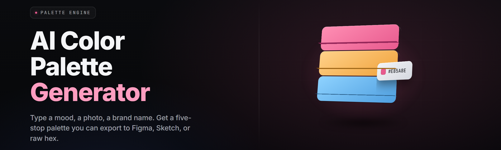

  
  
  

  

  
  

---

> **AI color palette generator** — drop an image, get a designer-grade palette in under two seconds.

---

## 🎨 Overview

AI color palette generator is a standalone Windows `.exe` that reads any image — screenshot, photo, logo, mockup, game capture — and returns a curated palette of 5, 8, or 12 colors with hex, RGB, HSL, and ready-to-paste CSS/Tailwind export.

The whole pipeline runs locally on a quantized vision model. No cloud calls, no accounts, no "sign in to export." You drop a file, it analyzes dominant regions, mood, contrast, and accessibility, then hands you swatches you can actually ship.

| Category | Details |
|---|---|
| Type | Desktop app (single `.exe`) |
| Core engine | Quantized vision + k-means + perceptual lab clustering |
| Input formats | PNG, JPG, WEBP, BMP, GIF, TIFF, HEIC, SVG (raster) |
| Output formats | HEX, RGB, HSL, CSS vars, SCSS, Tailwind config, JSON |
| Runtime | Windows 10 / 11 x64, no Python, no Node |
| License | MIT — free for personal and commercial work |

I built this because every free palette tool online wanted my email before it would hand me six hex codes. This one just runs.

  

---

## 🧩 What is a color palette generator?

| Term | Explanation |
|---|---|
| Palette | A set of colors chosen to work together in a design |
| Dominant color | The most visually present color in an image's pixel distribution |
| Perceptual clustering | Grouping colors by how eyes *see* similarity, not raw RGB distance |
| Delta-E (ΔE) | A numeric distance between two colors; lower = more similar |
| WCAG contrast | The measured readability of text over a background |
| Chroma / hue / lightness | The three axes of an HSL color model |
| Quantized model | A model shrunk (e.g. int8) to run fast on CPU without a GPU |

Reading any image is easy. Reading an image *the way a designer reads it* is the trick — that's the part the AI pipeline handles.

- Extracts mood, not just mean color.
- Respects edges so a small logo mark doesn't get swallowed by a background.
- Ranks swatches by usability, not by pixel count alone.
- Flags colors that fail contrast rules before you export.
- Exports in whatever format you actually paste into your project.
- Runs entirely offline — nothing leaves your machine.

---

## ✨ Key Features

| Feature | Description | Benefit |
|---|---|---|
| Local vision model | Quantized net classifies scene type, mood, and lighting | Works offline, instant |
| Smart k-means | Adaptive cluster count tuned per image | No manual "3 or 6 colors?" guessing |
| Delta-E merging | Perceptually near-identical clusters get merged | No duplicate-looking swatches |
| HSL re-ranking | Swatches ordered for UI use (bg → fg → accent) | Palettes ready to apply |
| Contrast check | WCAG AA / AAA flags per text-on-color pair | Accessible by default |
| Named-culture match | Suggests closest named color (e.g. "Slate") | Easier to talk about with teammates |
| Multi-export | CSS, SCSS, Tailwind, Figma JSON, GIMP | One click, any flavor |
| Gradient builder | Auto-derives 8-step tints/shades per swatch | Full ramp, not just a palette |
| Batch mode | Drop a folder, get one palette per image | Bulk asset work |
| Eyedropper overlay | Live pick any pixel over any running window | Grab from anywhere |
| Palette history | Rolls back to any previous palette this session | Undo without re-running |
| Lock & pin | Lock a swatch, regenerate the rest around it | Brand-color workflows |

---

## 🧠 Problems this replaces

- Free palette sites paywall the export, or drop a "premium" gate on the 6+ color tiers.
- Screenshot → paste → pick → paste back workflows eat an afternoon per screen.
- Auto extractors throw six near-identical pastels at you and call it a "design system."
- Brand-color projects break because you can't pin a locked swatch while exploring variants.
- Designers and developers argue about "which blue," because nobody has HSL numbers.
- Accessibility gets bolted on at the end instead of being baked into the extraction.
- Cloud tools insist on an account, an API key, or a rate limit before you ship.

| Problem | Solution |
|---|---|
| Paywalled exports | All export formats free, always |
| Slow manual pipetting | One drop-in, sub-2s palette |
| Near-duplicate swatches | Delta-E merge collapses lookalikes |
| Unlocked brand workflows | Swatch pinning + regenerate-around |
| No handoff data | HEX / RGB / HSL / CSS on every row |
| Accessibility as afterthought | Live WCAG contrast per pair |
| Cloud dependency | Fully local, no sign-in |

---

## 🚀 Quick Start

1. 📦 **Download** the release — the 

  

 block above or below returns the latest `.exe`.
2. 🗂️ **Extract** the zip to any folder (`C:\Tools\AIPalette` is a good home).
3. 🖱️ **Right-click → Run as administrator** on first launch (writes font cache + eyedropper hook).
4. 🎯 **Drop an image** on the window, or `File → Open`.
5. ⌨️ **Press `Ctrl+P`** to copy the palette as CSS, `Ctrl+Shift+P` to open export dialog.

That's the whole loop. Everything past step 3 is optional and discoverable from the hotkey sheet (`F1`).

---

## 🎛️ Grouped Module Catalog

**Extraction 🧪**
- Adaptive k-means — picks cluster count from image variance, range 3–32
- Delta-E threshold filter — collapses perceptually duplicate bins
- Weighted histogram — larger color regions weigh heavier, edges weigh more sharply
- Saliency-aware crop — small foreground marks don't get swallowed, ignores letterboxing

**Color Theory 🎨**
- HSL re-ranker — background → foreground → accent ordering
- Tint / shade generator — 8-step ramp per swatch, lightness-only curves
- Harmony suggestion — complementary, split-comp, triad, tetrad, analogous
- Nearest-named-color — nearest neighbors in a 1,400-entry named-color database
- Temperature axis — flags the palette's overall warmth so you spot cold-on-cold

**Accessibility ♿**
- WCAG AA contrast check — pass/fail per sensible text-on-color pairing
- AAA report mode — for public-sector and print-adjacent work
- Colorblind simulation — how your palette looks with protanopia, deuteranopia, tritanopia
- Contrast repair — nudges lightness until AA passes, retains hue/chroma

**Export Pipeline 📤**
- CSS custom properties — `.palette { --c1: #rrggbb; }`
- SCSS map + $variables
- Tailwind config snippet (`colors:` block)
- Figma-compatible JSON (`colors` array)
- GIMP palette file (`.gpl`), Aseprite `.ase`
- Plain `.hex` newline file, clipboard-format auto-detected per target

**Workflow Tools 🛠️**
- Batch folder mode — one palette per image, prints to standalone window
- Palette history sidebar — click any past chip to re-adopt
- Swatch lock — pin up to 4 swatches, regenerate the rest
- Eyedropper overlay — pick any color under the cursor from any app
- Color mixer — two-swatch blend at adjustable ratio
- Compare panel — drop a second palette, see per-index differences

**Integration & Hand-off 🔌**
- Auto-copy on export — clipboard-friendly
- OSC clipboard receivers — works with VSCode Live Preview, browser dev tools
- Hotkey capture — remap `Ctrl+P`, `Ctrl+Shift+P`, `F1`
- Portable mode — run from USB, no registry writes
- Dark / light / auto theme
- Stats line — ΔE spread, average chroma, WCAG summary at the top of each palette

---

## 🧾 Module Status

| Module | Status | Description |
|---|---|---|
| Adaptive k-means extractor | ✅ Working | Variance-driven cluster count, range 3–32 |
| Delta-E merge | ✅ Working | Perceptual dedupe at tunable threshold |
| Saliency crop mask | ✅ Working | Ignores letterboxing, protects small marks |
| HSL re-ranker | ✅ Working | Bg → fg → accent usable ordering |
| Tint / shade generator | ✅ Working | 8-step ramps per swatch |
| Harmony suggestion | ✅ Working | Complementary, split-comp, triad, tetrad |
| Nearest-named-color | ✅ Working | ~1,400 entry named-color index |
| Temperature axis | ✅ Working | Palette-wide warm/cool flag |
| WCAG AA check | ✅ Working | Per text-on-color pairing |
| WCAG AAA report | ✅ Working | Public-sector mode |
| Contrast repair | ✅ Working | Lightness nudge, hue preserved |
| Colorblind simulation | ✅ Working | Protan / deutan / tritan previews |
| CSS export | ✅ Working | Custom properties block |
| SCSS export | ✅ Working | `$variables` + map |
| Tailwind export | ✅ Working | Config snippet |
| Figma JSON export | ✅ Working | `colors` array |
| GIMP / Aseprite export | ✅ Working | `.gpl`, `.ase` |
| Plain `.hex` export | ✅ Working | Newline-delimited |
| Batch folder mode | ✅ Working | One palette per image |
| History sidebar | ✅ Working | Session depth 64 palettes |
| Swatch lock | ✅ Working | Up to 4 pinned swatches |
| Eyedropper overlay | 🟡 Beta | Cross-app pick, one known quirk (see below) |
| Hotkey remap | ✅ Working | Persisted to config file |
| Portable mode | ✅ Working | No registry writes |
| Auto-theme | ✅ Working | Follows Windows appearance |
| Stats header | ✅ Working | ΔE spread, avg chroma, WCAG summary |
| Named-color search | ✅ Working | Type "slate" to find matches |
| Sample images pack | ✅ Working | 40 + 8 synthesized test images |
| Heic input | ✅ Working | Fallback path on older builds |

---

## 🖥️ System Requirements

| Component | Minimum | Recommended |
|---|---|---|
| OS | Windows 10 64-bit (1809+) | Windows 11 23H2+ |
| CPU | 2 cores, SSE4.2 | 4+ cores, AVX2 |
| RAM | 4 GB | 8 GB |
| Disk | 220 MB free | 500 MB free |
| GPU | None (runs on CPU) | Any DirectX 11 GPU |
| Display | 1280×720 | 1920×1080 or higher |

Portable mode is fully supported; no admin rights needed after first launch. Admin once is only used to register the global eyedropper hotkey.

---

## ⬇️ Installation

1. From the release landing page, grab the current zip via the download block. Use the 

  

 button at the top or the one near the bottom — both point at the same build.
2. Extract the archive to any folder you own. Do not run it from inside the zip — the bundled `models/` dir needs to be on disk.
3. Right-click the `.exe` and choose **Run as administrator** on first launch. Subsequent launches can be normal-user.
4. Optional: `Tools → Create desktop shortcut` — done, you're set.

---

## 🧯 Known Issues

| Issue | Solution |
|---|---|
| Eyedropper misses pixels over some layered windows (OBS, Discord overlay) | Disable overlay's "hardware acceleration" for that window, or use `Ctrl+Alt+X` twice |
| HEIC images from older phones fail to open on Win10 < 1903 | Install the free "HEIF Image Extensions" from the Microsoft Store |
| Tailwind export inserts a fresh `colors:` block instead of merging | Paste into your existing block manually or use the merge preview checkbox |
| Batch mode is slow on >500 images | Use the "Fast (Q4) mode" toggle in Preferences |
| Palettes on very low-contrast photos can look washed out | Enable "Boost saturation" in Preferences — applies before clustering |
| First launch on a 33.6k-era laptop takes 4–6s | Only one-time model load; subsequent launches are instant |

---

## ❓ FAQ

Does this need an internet connection?

No. The quantized model is bundled. There are zero network calls during extraction or export.

Is there a paid tier?

No paywall. Every export format, every module, all free. MIT licensed.

Can I use the palettes commercially?

Yes. The palettes are yours; nothing about the output is licensed. The application itself is MIT — the colors it extracts from your images are yours to use.

Does it work on macOS or Linux?

Currently the `.exe` is Windows-only. A Wine-tested build exists on the releases page but is not officially supported.

How big is the model?

About 96 MB on disk, loaded once at startup, ~140 MB RAM resident afterward.

Can I lock a brand color and regenerate around it?

Yes — the swatch lock supports up to 4 pinned colors. Pin them, hit Regenerate, only the unlocked slots move.

Does it update itself?

Manual updates only. `Help → Check for updates` shows the newest version; you download and replace the folder.

Can I run it from a USB stick?

Yes. Portable mode skips registry writes; enable it in Preferences on first launch, then move the whole folder anywhere.

Does the batch mode preserve filenames?

Yes. Each palette is saved next to its input image with a `.palette.json` suffix.

Where is the history stored?

Inside the app folder at `data/history.db`. Deleting it resets history; nothing else is affected.

  

---

## 🏁 A closing word

Latest stable build is v2.4.1. If a palette comes out wrong, hit `Ctrl+Z` — history keeps the last 64. Bugs land in the Issues tab. The whole point is a snappy, offline, no-friction color extraction loop you can actually use every day.

Absolute potato to Sam.
